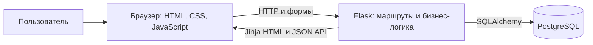
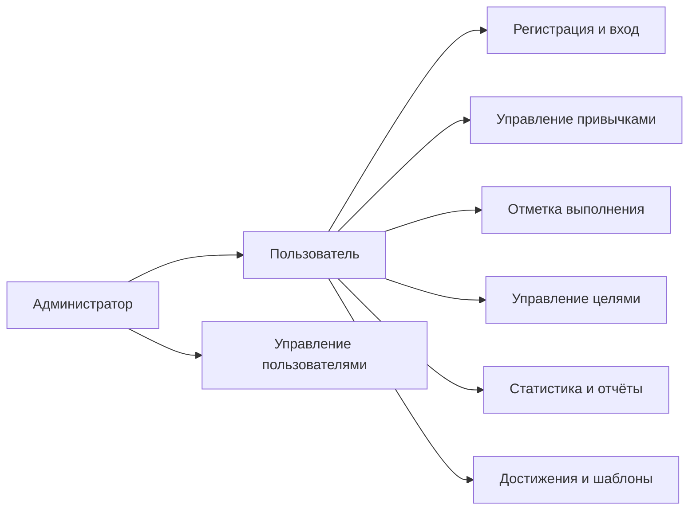
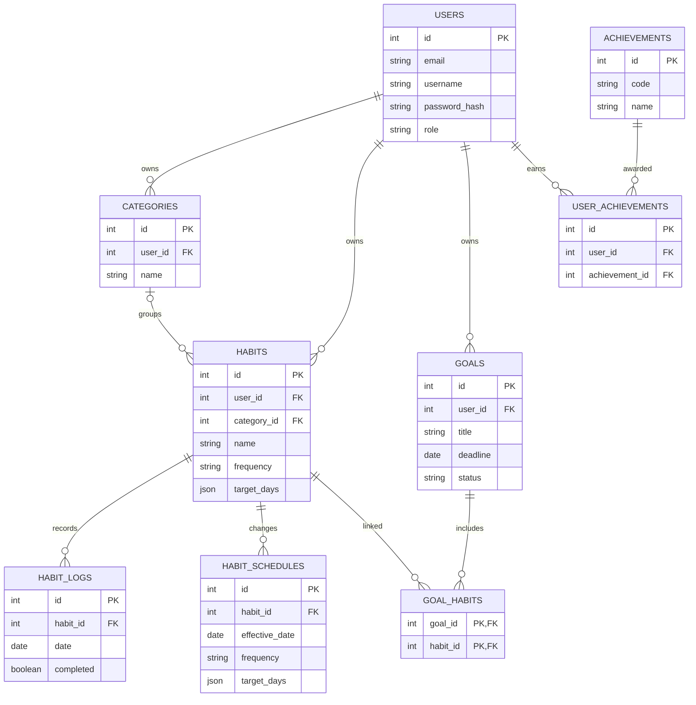

# Схемы HabitFlow

Эти исходники Mermaid можно открыть в редакторе с поддержкой Mermaid и экспортировать в рисунки для пояснительной записки.

## Архитектура

## Основные действия

## Основные сущности

